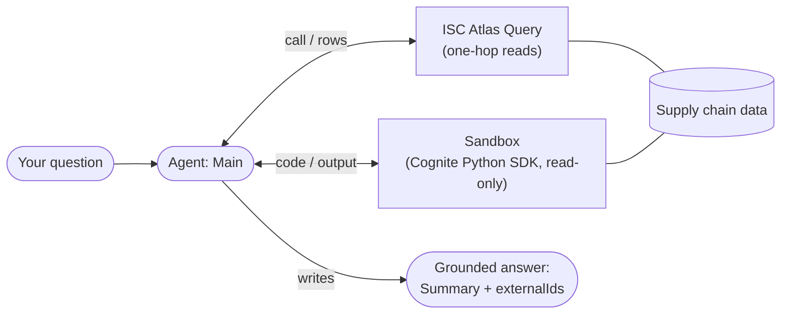
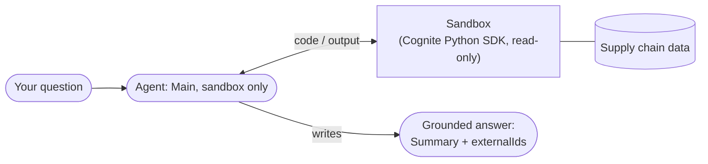
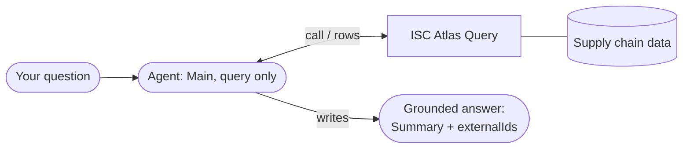

# Atlas agents and skills

*The Atlas agents and skills this training repo ships, how they're scoped, how a question gets answered, and how to use them in Atlas chat.*

**Who this is for:** trainees exploring the ISC demo data through Atlas, and anyone configuring the agents.

## The agents

This repo ships 3 Atlas agents, all under `isc_atlas_agents/agents/`. No Functions are involved anywhere — every agent reads data through either a Query tool or the sandbox, both built into the agent runtime:

| externalId | Name | Runtime | Skills attached |
|---|---|---|---|
| `integrated-supply-chain-main-agent` | Integrated Supply Chain (Main) | `2.0.0` (has a sandbox) | `isc-model`, `isc-query`, `isc-sandbox` |
| `integrated-supply-chain-main-agent-sandbox-only` | Integrated Supply Chain (Main, sandbox only) | `2.0.0` | `isc-model`, `isc-sandbox` |
| `integrated-supply-chain-main-agent-query-only` | Integrated Supply Chain (Main, query only) | `1.3.0` (no sandbox) | `isc-model`, `isc-query` |

All 3 are **independent agents and alternatives to each other**. You pick one per deployment or demo. They are functionally identical — same instructions, same answer format, same example questions — and differ only in which data path they're allowed to use. They don't call each other, hand off, or work as a team, and there are no subagents.

**ISC Atlas Query** is a *tool*, not an agent or a Function. An agent calls it to read data and gets rows back; it has no instructions or skills of its own and never writes an answer. The **sandbox** (read-only Cognite Python SDK) isn't a separate configured tool either — it's a built-in capability of agent runtime `2.0.0`, available to any agent on that runtime.

## Choosing an agent

| Agent | How it reads data | Choose it when |
|---|---|---|
| **Main** | ISC Atlas Query **and** the sandbox | **The general case — start here.** It uses Query for one-hop reads and the sandbox for everything deeper, picking per question. |
| **Main, sandbox only** | Sandbox only | You don't want to expose the Query tool. |
| **Main, query only** | ISC Atlas Query only, runtime `1.3.0` (no sandbox) | You can't use the sandbox in your environment, or need an access-control posture the sandbox can't express. Multi-hop questions take more chained Query calls here than Main would need with the sandbox. |

Because the agents are alternatives, deploy and expose the one that fits. You can compare them yourself by asking the same question to each.

There is no separate monitoring agent. Delay and exception questions are reads like any other.

## The skills

| Skill | What it covers | Used by |
|---|---|---|
| `isc-model` | What exists where: domains, view spaces, data models, node and edge views, hierarchies, and where each kind of value lives. Loaded first, before any read. | All 3 agents |
| `isc-query` | How to read with the ISC Atlas Query tool: which call fits which question shape, how to write filters, where the tool's reach ends (one view at a time). | Main, query-only |
| `isc-sandbox` | How to read with Cognite Python SDK code in the sandbox: multi-hop joins, hierarchy subtrees, complete lists, and arithmetic across records — plus worked chains for exposure, notification impact, landed cost, traceability, and competing demand. | Main, sandbox-only |

Skills explain the data and how to use a tool. The agent decides which tool to call and writes the answer.

## Scope

`isc-atlas-query-supply-chain-scope.yaml` is a reference copy, not a shared source every agent reads from. It lists all 8 data models (`isc_typed_model`, `OrganizationalFoundation`, `MaterialManagement`, `AssetMaintenance`, `SourcingProcurement`, `ShipmentDelivery`, `PlanForecast`, `IscPlatform`) and the shared instance space, and is kept in line with `isc_core/locations/energy_bridge_supply_chain.LocationFilter.yaml`. Main and query-only each carry their own inline copy of that same list, under their Query tool's `configuration.dataModels`. That's **three copies** in total — the reference file plus one each in Main and query-only. (Sandbox-only has no Query tool, so no copy there.) Edit one, edit all three, or they drift out of sync.

## How each agent answers a question

In every diagram below, the rounded box is the **agent** and the rectangle is the **data path**. The agent reads data and writes the answer itself — the data path never writes an answer.

### Main (general case)

One agent, two data paths. It loads `isc-model` first, then calls Query, the sandbox, or both in turn, using what one returns to decide the next call.



### Main, sandbox only

One agent, one data path. Every read, simple or deep, goes through the sandbox.



### Main, query only

One agent, one data path, no sandbox. Every read — one-hop or multi-hop — goes through Query, chaining calls and carrying resolved externalIds into the next one when a question needs more than one hop.



| Data path | What it does | Use it for | Available to |
|---|---|---|---|
| **ISC Atlas Query** | Direct read of one view: retrieve, filter, search, count, aggregate, or the edges from one anchor | One named record; one view with a filter; a count or total; the edges from one anchor | Main, query-only |
| **Sandbox** | Read-only Cognite Python SDK code the agent writes and runs | Two or more hops; every descendant of a hierarchy node; a join across views; "all" or "every"; arithmetic across records | Main, sandbox-only |

Whichever agent you use, it states in the Summary which assumptions it made: the as-of date, the filter used, and whether rows were capped.

## Deployed as part of `isc_atlas_agents`

Agents and Skills ship as YAML under `isc_atlas_agents/agents/`. The module depends on `isc_core`, whose data models, instance space and location filter the agents query, so deploy them together. Toolkit only recognizes the Agent and Skill resource kinds with `[alpha_flags]` set (`agents = true`, `agent-skills = true` in `cdf.toml`) — see [Overview and prerequisites](../isc-deployment/1-overview-and-prerequisites.md).

## Quick start

1. Open **Atlas** → **Agent library**.
2. Start with **Integrated Supply Chain (Main)**, the general-case agent. Pick a variant only if one of the cases in [Choosing an agent](#choosing-an-agent) applies.
3. Ask in natural language; include `externalId`s when you know them. These resolve only if the [seed workflow](../isc-deployment/3-load-seed-data.md) has loaded the demo graph.
4. Expect a **Summary** plus bullets or a table with cited IDs — not vague paraphrases.

## Which path answers what?

The table shows what **Main** does, since it has both data paths. The sandbox-only agent answers all of these with the sandbox. The query-only agent answers all of these too, by chaining Query calls instead.

| Question | Path Main uses |
|---|---|
| A named record's own fields, status, or quantity | ISC Atlas Query |
| PO line pegged to a scheduled receipt | Query — retrieve the receipt |
| Active supplier contract for a material | Query — `SupplierContract` filtered on material |
| Cost centers directly under a business unit | Query — `CostCenter` filtered on `parent` |
| Every cost center *below* a business unit, at any depth | Sandbox — hierarchy subtree |
| If a supplier fails, which shipments are exposed | Sandbox — multi-hop exposure chain (`Supplier` → `SupplierFacility`/`SupplierSuppliesMaterial` → `Shipment`) |
| Countries where assets are present | Sandbox — join across the geo hierarchy and `FunctionalAsset` |
| "All" or "every" of something, where one page is not enough | Sandbox — reads to the end |
| Delays or exceptions on shipments | Query the shipment or lane edge directly; a delay cascade across several shipments is a sandbox read |

## What a good answer looks like

```markdown
## Summary
Direct answer in one or two sentences.

## Findings
- Bullet or table with **externalIds**
- Status, quantities, dates when relevant
```

**Do expect:** `externalId`s copied from data, not paraphrased; tables when listing several entities; empty sections omitted.

**Do not expect:** write-back to source systems; answers without IDs when the graph returned them; guaranteed exhaustive lists on paginated reads.

## Sample prompts (demo data)

These are the example questions shipped on all 3 agents, answerable against the demo data loaded by the [seed workflow](../isc-deployment/3-load-seed-data.md). Use with **Integrated Supply Chain (Main)**:

- *What are different countries where we have assets present?*
- *What's the status of shipment shp-29198?* (it's seeded as `Delayed`, with a supplier port-congestion delay reason)
- *List the cost centers under business unit bu-ops* (`cc-alpha`, `cc-bravo`, `cc-darwin`)
- *Which scheduled receipt is linked to PO line poi-1869351-10?* (`sr-29198`)
- *What work orders are open against functional asset fa-energy_bridge-alpha?*
- *Which suppliers does transportation lane lane-sin-darwin connect?*
- *What's the lead time on lane lane-per-darwin?*

## Troubleshooting

| Symptom | Likely cause | What to do |
|---|---|---|
| Agent not in library | Agents not deployed, or the deploy identity lacks the capability needed for Agents ([Overview and prerequisites](../isc-deployment/1-overview-and-prerequisites.md#before-you-start)) | `cdf deploy` the `isc_atlas_agents` module (it must be in `selected`); check the service principal's capabilities |
| Query failed / REST 400 | Bad filter or wrong view space | Rephrase with an explicit `externalId` |
| Vague IDs ("the shipment") | Model or skill drift | Use `externalId`; check which agent variant you're on |
| "No data" for a known seed anchor | Seed workflow hasn't run, or didn't complete | Check the seed workflow run — [Load the seed data](../isc-deployment/3-load-seed-data.md) |
