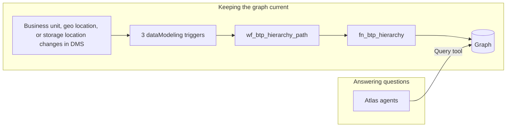

# Functions and workflows

*What runs behind the agents and keeps the graph current: 1 Function, 2 workflows, and the transformations the demo workflow orchestrates.*

**Who this is for:** trainees and instructors who want to understand how ISC is built, technically.

## Which module owns what

| Module | Functions | Workflows and triggers |
|---|---|---|
| `isc_core` | `fn_btp_hierarchy` | `wf_btp_hierarchy_path` with 3 triggers |
| `isc_atlas_agents` | None. Agents answer questions via a `Query` tool straight against the graph — no Functions involved. | None |
| `isc_seed_data_ingestion` (demo only) | None | `wf_btp_energy_bridge_data`, manual start |

## Functions

| Function | Group | What it does | Reads / writes | Called by |
|---|---|---|---|---|
| `fn_btp_hierarchy` | Platform job | Path sync — fills `root`/`path`/`pathLastUpdatedTime` after a hierarchy write | Reads DMS parent chains, writes `root`/`path`/`pathLastUpdatedTime` | `wf_btp_hierarchy_path` |

## Workflows

| Workflow | Purpose | Starts | Calls |
|---|---|---|---|
| `wf_btp_hierarchy_path` | Path sync after a hierarchy write | 3 `dataModeling` triggers — `BusinessUnits`, `GeoLocations`, `StorageLocations` | `fn_btp_hierarchy` (`path_sync_cursor` mode) |
| `wf_btp_energy_bridge_data` (demo only) | Load the demo graph: `DeclaredTypes` → hierarchies → domain data | Manual only, version `1` — [page 3](../isc-deployment/3-load-seed-data.md) | 32 transformations in dependency order |

These are the only two workflows shipped in this repo. `wf_btp_hierarchy_path` is the one piece of "always-on" platform plumbing — it's what keeps the typed hierarchy views (`root`/`path`) correct as business units, geo locations, and storage locations change. `wf_btp_energy_bridge_data` is a one-time, manually-started demo loader — it's how the seed data gets into the graph in the first place, not something that runs continuously.

## Triggers

3 `dataModeling` triggers in total, all in `isc_core/workflows/` — there's no archive module and nothing else in this repo starts a workflow automatically.

| Starts | Module | Count | One per |
|---|---|---|---|
| `wf_btp_hierarchy_path` | `isc_core` | 3 | `BusinessUnits`, `GeoLocations`, `StorageLocations` |

`wf_btp_energy_bridge_data` has none — it never starts automatically. It has a documented manual start instead ([page 3](../isc-deployment/3-load-seed-data.md)).

## Transformations

32 SQL transformations load the RAW seed tables into the `isc_core` domain data models. They're not a simple front-to-back sequence — `wf_btp_energy_bridge_data` runs them as a dependency graph (each task's `dependsOn` list controls when it's eligible to run, and independent tasks run in parallel). A handful of tasks have no dependencies and start immediately: `DeclaredTypes`, both `FunctionalAsset` enrichment tasks (`visualizable`, `sourceable`), `Supplier`, and `MasterNotification`. Everything else builds outward from there — for example, `GeoLocation` and `BusinessHierarchy` depend on `DeclaredTypes`; `FunctionalAsset` depends on both enrichment tasks plus `GeoLocation` and `BusinessHierarchy`; and downstream transactional data (shipments, purchase orders, reservations, lot placements) depends on combinations of `FunctionalAsset`, `Supplier`, `MaterialMaster`, and the storage/geo hierarchies.

## How they fit together

The seed workflow `wf_btp_energy_bridge_data` (manual start, [page 3](../isc-deployment/3-load-seed-data.md)) sits outside this steady-state picture — it's how the demo graph gets populated in the first place, not something that runs continuously.

## Where to look

In Fusion: **Functions** for `fn_btp_hierarchy`'s Ready status, **Workflows** for trigger status and run history on both `wf_btp_hierarchy_path` and `wf_btp_energy_bridge_data`, **Transformations** for run logs on the seed load.
