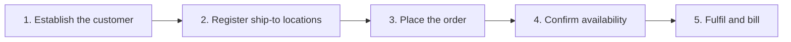

# Customer Demand Fulfilment

> [!NOTE]
> Part of [Integrated Supply Chain](../overview.md). One of 7 core domains.

Customer Demand Fulfilment tracks who is buying, where the goods go, and what each customer asked for compared with what the business has promised.

## Why it matters

This is the demand side of ISC. Availability checks, allocations, production plans and shipments all resolve back to a line on a customer order. The domain keeps three things apart: the customer (who is buying), the delivery location (where goods go), and the order (what was asked for and what has been decided since).

## Key concepts

| Concept | What it is |
|---|---|
| Customer | The party responsible for the order commercially, who places it and is billed for it (the sold-to). |
| Customer location | A physical delivery site (the ship-to) that belongs to a customer. A customer can have several. |
| Customer order | A header and one or more lines, recording what a customer asked for and what the business has confirmed. |
| Sold-to and ship-to | The sold-to customer is billed. The ship-to location receives the goods. The two can differ. |
| Ordered and confirmed quantity | What the customer asked for, and what the business has committed to deliver. Confirmed can be less when stock or capacity is short. |
| Promise basis | How a line's confirmed quantity and date were worked out: from stock, a production schedule, an inbound delivery, an allocation, or a manual decision. |
| Allocation | Supply set aside ahead of firm demand, for a customer or segment. An order line can use an allocation instead of general stock. |
| Pegging | Linking a specific piece of supply, such as a production schedule or a reservation, to the order line it exists to satisfy. |
| Product grade tolerance | The minimum grade a customer contracted for and the lowest grade it will still accept. It helps match off-spec production to orders that can still use it. |
| OTIF | On time, in full. The combined delivery and fill-rate measure the statuses and customer figures here support. |

## From customer to delivery

**Set up (once)**

1. **Establish the customer.** The relationship comes from the source ERP or CRM, with its credit limit, credit status, payment terms and default delivery priority.
2. **Register ship-to locations.** Each delivery site is recorded under its customer. A site can override the customer's delivery priority, payment terms and delivery terms.

**For each order**

3. **Place the order.** The customer's request becomes an order: a header with the parties and dates, and one or more lines, each with the item, quantity and requested delivery date.
4. **Confirm availability.** Each line is checked against supply: stock, a production schedule, an inbound delivery or an allocation. The result is recorded as how the promise was made, the confirmed quantity and the confirmed date. The confirmed quantity can be less than ordered. Reservations, allocations and production pegs attach to the line as evidence of the commitment.
5. **Fulfil and bill.** As goods ship and are invoiced, the line's status, the order's delivery status and its billing status move toward completion. A line can also be rejected or blocked.

## How it connects

- **[Material Management](./material-management.md)**: stock is reserved for an order line.
- **[Planning & Forecasting](./planning-and-forecasting.md)**: an order line can use an allocation that was set aside ahead of firm demand.
- **Manufacturing**: a production schedule can be pegged to the order line it exists to satisfy.
- **[Shipment & Delivery](./shipment-and-delivery.md)**: deliveries are planned and carried out against order lines.
- **[Organizational Foundation](./organizational-foundation.md)**: customers and delivery sites sit in the location hierarchy.

## Questions it helps answer

**Who and where?**
- Who is the customer, and where does it want its goods delivered?
- Does this order's ship-to differ from its sold-to?

**Asked for versus promised**
- What did the customer order, and how much have we confirmed?
- How was this line's promise made, and what is it pegged to?

**Can we deliver?**
- Which orders are at risk of missing their confirmed date?
- Which customers are on credit hold?

## An example

A customer places an order with two lines, asking for delivery on 20 July.

| Line | Ordered | Confirmed | Promised from | Confirmed date |
|---|---|---|---|---|
| 1 | 600 | 600 | Stock (a reservation) | 20 July |
| 2 | 400 | 250 | A production schedule (a peg) | 25 July |

Line 1 is fully covered. Line 2 is confirmed for 250 units, five days late, because production can't supply more sooner. A planner can see both gaps at once, and which supply each line depends on.

## Things to know

- **This is often the far end of a question.** Reservations, allocations and production pegs all resolve to an order line here.
- **Confirmed is a commitment, not a forecast.** It can be lower than ordered, and the promise basis records why.
- **Sold-to and ship-to can differ.** Billing questions go to the customer. Delivery questions go to the location.
- **A site can override the customer.** Delivery priority and terms set on a location take precedence over the customer's defaults.

**Next:** [Shipment & Delivery](./shipment-and-delivery.md)