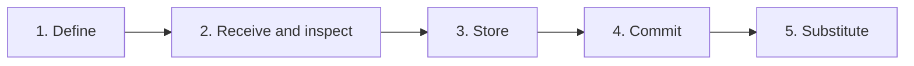

# Material Management

> [!NOTE]
> Part of [Integrated Supply Chain](../overview.md). One of 7 core domains.

Material Management tracks which materials the business deals with, how much of each it holds and where, and how much of that is already promised to someone.

## Why it matters

Procurement, manufacturing, maintenance, logistics and planning all refer to materials. Material Management is where those references resolve to one record, so every domain sees the same material and the same stock position.

## Key concepts

| Concept | What it is |
|---|---|
| Material | Anything the supply chain buys, makes, stores or uses: raw material, semi-finished or finished goods, spares, packaging, services. |
| Lot | A quantity of one material produced or received together and tracked as a unit, for traceability and shelf life. |
| Warehouse, zone, bin | The three levels of storage. A bin is the smallest place that can hold stock. |
| On-hand quantity | Stock physically present. Tracked per bin and totalled per warehouse. |
| Reservation | A commitment of on-hand stock to a demand, so the same quantity isn't promised twice. |
| Safety stock and reorder point | Planning thresholds: the buffer to keep, and the level at which to reorder. |
| Approved substitute | A material that can be used when the preferred one is unavailable. |
| Usage decision | The result of a quality inspection: stock is released, restricted, blocked or returned. |

## From definition to reservation

1. **Define the material.** It is created in the source ERP system and brought in with its classification, unit of measure, and handling and stock rules.
2. **Receive and inspect.** An expected delivery arrives and is received against it. If quality management applies to the material, the delivery is inspected and the result sets the usage decision.
3. **Store.** Accepted stock becomes a lot and is stored in one or more warehouse bins. The model records the quantity in each bin and the total position per warehouse.
4. **Commit.** When a work order, production request or customer order needs the material, the quantity is reserved. A reservation records how much, for what, its status, and from when to when.
5. **Substitute.** If the preferred material is short, an approved substitute can be used. Each one has a preference order and a conversion factor, so the business knows which to use and how much equals the original.

## How it connects

- **[Customer Demand Fulfilment](./customer-demand-fulfilment.md)**: stock is reserved for a customer order.
- **Asset Maintenance**: stock is reserved for the parts a work order needs.
- **Manufacturing**: stock is reserved for a production request.
- **[Shipment & Delivery](./shipment-and-delivery.md)**: expected deliveries are received into stock, and each transportation lane carries specific materials.
- **[Sourcing & Procurement](./sourcing-and-procurement.md)**: each supplier's price and lead time apply to one specific material.
- **[Planning & Forecasting](./planning-and-forecasting.md)**: allocations set aside future stock against a forecast.
- **[Technical Structure](./technical-structure.md)**: each bill-of-materials component line points back to one material record here.

## Questions it helps answer

**Where is it?**
- What stock do we hold of this material, and in which warehouse and bin?
- Which bin holds this lot?

**What is it committed to?**
- What is this lot reserved for right now?
- How much of this material is still free?

**Can we use it, or replace it?**
- Was this stock released after inspection?
- Which approved substitute can we use, and how much of it equals the original?

## An example

A lot of 500 units sits in one bin. Three reservations are active:

| Held for | Quantity | Until |
|---|---|---|
| A repair (Asset Maintenance) | 50 | 5 July |
| A customer order | 300 | 15 July |
| A production request | 100 | 20 July |

50 units are free. After 5 July the repair hold ends and 100 are free.

## Things to know

- **On hand is not the same as free.** On hand is what is physically there. Free is what remains after active reservations.
- **Reservations have dates.** You can ask what a lot was reserved for on a past day, not only today.
- **Several holds on one lot are normal.** Each hold keeps its own quantity and dates.
- **Quality can block stock.** A usage decision of blocked or restricted limits how the stock can be used.

**Next:** [Technical Structure](./technical-structure.md)