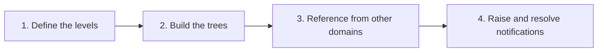

# Organizational Foundation

> [!NOTE]
> Part of [Integrated Supply Chain](../overview.md). One of 7 core domains, and the one the others build on.

Organizational Foundation holds the shared structures every other domain points into: where things are, which part of the organization owns them, how products are classified, and which supply chain events need attention.

## Why it matters

Every question needs a scope: one business unit, one region, one site, one product family. This domain provides those scopes as trees, so any other domain can answer for just that part of the business. It holds no orders or other transactions of its own. Customers, suppliers, routes, schedules, allocations, storage locations and equipment all point into it. It also holds notifications, which record critical events and link each one to everything it affects.

## Key concepts

| Concept | What it is |
|---|---|
| Hierarchy | A tree that rolls up from detail to the top, such as a cost center up to its business unit, or a city up to its country. |
| Level | One kind of position in a tree, such as company, country or product family. Every item in a tree belongs to one level. |
| Branch | An item and everything beneath it. A whole branch can be read in one step, so a question can cover a region or a unit at any level. |
| Business hierarchy | The organizational structure: company, controlling area, business unit, cost center, profit center and purchasing organization. |
| Geographic hierarchy | The location structure: region, country, county and city. |
| Product hierarchy | The classification structure: product sector, family, group and subgroup. Materials are assigned to it. |
| Master notification | A logged supply chain event, such as a delay, shortage or schedule exception, with its priority, state change and resolution. |
| Notification link | The connection from a notification to something it affects, recording the link's role, its severity and a reference that ties related links together. |

## From levels to notifications

1. **Define the levels.** The kinds of level are set up first, such as company, country and product family. Each says which tree it belongs to.
2. **Build the trees.** Business, location and product items are loaded with their level and their parent. The path from each item to the top is kept up to date automatically, so a whole branch can be read at once.
3. **Reference from other domains.** Other domains point into the trees. They don't copy them.
4. **Raise and resolve notifications.** When a critical state changes, a notification records the event, its priority and the state before and after. It is linked to what it affects, acknowledged by someone, and tracked until it is resolved.

## How other domains use it

| Domain | What points into Organizational Foundation |
|---|---|
| [Material Management](./material-management.md) | Storage locations sit in a city and a cost center. Materials are assigned to product groups. |
| Asset Maintenance | Equipment sits in a city and a cost center. Work orders belong to a business unit, and notifications link to work orders. |
| Manufacturing | Production schedules belong to a business unit, and notifications link to the schedules they disrupt. |
| [Customer Demand Fulfilment](./customer-demand-fulfilment.md) | Customers and delivery sites sit in the location hierarchy. |
| [Sourcing & Procurement](./sourcing-and-procurement.md) | Supplier sites sit in the location hierarchy, and orders carry a purchasing organization. |
| [Shipment & Delivery](./shipment-and-delivery.md) | Routes and shipments start and end at locations in the hierarchy. |
| [Planning & Forecasting](./planning-and-forecasting.md) | Allocations are set for a location and a product. |

## How notifications work

- **One notification can affect several things.** It can link to a work order and a production schedule at once.
- **Each link keeps its own role and severity.** The same event can be high for one thing and low for another.
- **A notification moves from open, to acknowledged, to resolved.** Who acknowledged it and when, the resolution date and a note are recorded.

## Questions it helps answer

**What belongs where?**
- What sits under this business unit or region?
- Which cost centers and sites roll up to this unit?

**What is going wrong?**
- Which open notifications affect this site?
- Which notifications are acknowledged, and who owns them?

**What is the impact?**
- What does this notification affect, and how severe is it for each thing?
- Which open notification has the biggest estimated impact?

## An example

A vibration alarm on a packing line raises a notification. It is linked to the repair work order and to the production schedule that uses the line, each with its own role and severity. From the schedule, the connection leads on to the customer order that depends on it. A planner sees the whole impact from one notification, and can limit the view to a single site by choosing its place in the location tree.

## Things to know

- **It holds structure, not transactions.** Orders, shipments and work orders live in the other domains.
- **Severity is recorded when the link is made.** You can see how serious it was then, not only now.
- **Any level of a tree can scope a question.** You don't have to ask about the whole business.
- **Resolved notifications are archived after a retention period.** They leave the live view, and the history is kept.

**Next:** [Material Management](./material-management.md)