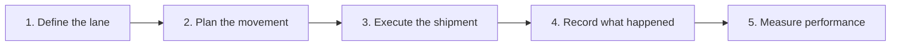

# Shipment & Delivery

> [!NOTE]
> Part of [Integrated Supply Chain](../overview.md). One of 7 core domains.

Shipment & Delivery tracks how material moves: the route it takes, what is planned to move and when, which shipment is carrying it, and how closely the result matched the plan.

## Why it matters

This is the movement side of ISC. Inbound deliveries from suppliers, transfers between sites and outbound deliveries to customers all resolve to a shipment travelling one or more routes. The domain keeps three things apart: the route, the plan and the execution. That separation lets you compare what was planned with what actually happened.

## Key concepts

| Concept | What it is |
|---|---|
| Transportation lane | A planned, repeatable route between two points in the network, with its own mode of transport, lead time and status. |
| Scheduled receipt, transfer and delivery | The plan: a commitment to move material inbound from a supplier, between sites, or out to a customer, before it has moved. |
| Shipment | The physical movement itself: one carrier journey, tracked from departure to arrival. |
| Execution record | What actually happened against a plan line: the shipping notice, the bill of lading, actual quantities and dates, and any discrepancy. |
| Advance shipping notice (ASN) | The sender's notice of what is being shipped and when, sent before the goods arrive. |
| Bill of lading | The carrier's document confirming what was loaded. It is the reference for transit and customs. |
| Leg | One hop of a shipment's route over a single lane. A shipment with several hops has several legs in sequence. |
| Lead time variance | The gap between a lane's planned lead time and its recent actual transit times. It flags routes whose planning data needs recalibrating. |
| OTIF | On time, in full. The combined date and quantity measure the variance figures support. |

## From route to performance

**Set up (once)**

1. **Define the lane.** A lane is created between two points with a planned lead time and a mode of transport. It lists the materials it carries, each with its own cost, lot size limits and handling rules.

**For each movement**

2. **Plan the movement.** A scheduled receipt, transfer or delivery is created against the commercial document behind it: a purchase order line, a stock transfer order, or a customer order line. The plan copies the lane's lead time as its planned transit time.
3. **Execute the shipment.** A shipment is created with a carrier and a mode of transport, and travels one or more lane legs. Each leg records its actual transit time, cost and any delay reason.
4. **Record what happened.** As the shipment moves, the execution record captures the shipping notice, the bill of lading, and the actual quantities and dates against the plan line. It also notes any discrepancy, damage or quality hold.
5. **Measure performance.** The variance figures roll up into on-time, in-full and lead-time-drift signals. These flag routes and suppliers for review.

## How it connects

- **[Sourcing & Procurement](./sourcing-and-procurement.md)**: inbound receipts are planned against purchase order lines and supplier confirmations.
- **[Customer Demand Fulfilment](./customer-demand-fulfilment.md)**: deliveries are planned against customer order lines.
- **[Material Management](./material-management.md)**: each lane carries specific materials, and received stock goes into storage.
- **[Organizational Foundation](./organizational-foundation.md)**: routes start and end at sites and warehouses in the location hierarchy.

## Questions it helps answer

**What is planned?**
- Which route does this shipment take, and how long should it take?
- What is expected to arrive at this site this week?

**What actually happened?**
- Which shipments are delayed, and why?
- What was received against this plan line, and was anything short or damaged?

**How did it perform?**
- Which routes are drifting from their planned lead time?
- Which suppliers deliver late or short most often?

## An example

A supplier's delivery of 400 units is planned for a route with a lead time of 3 days.

| | Planned | Actual |
|---|---|---|
| Transit time | 3 days | 5 days (delay reason: port congestion) |
| Quantity | 400 | 392 received, with 8 recorded as damaged |

The delivery is two days late and 8 units short. Over several shipments, the same route shows a steady gap between planned and actual transit, so the route is flagged for its lead time to be reviewed.

## Things to know

- **Route, plan and execution are separate.** Changing a route's lead time later doesn't rewrite plans already made, because each plan keeps the lead time it started with.
- **Costs and delay reasons belong to the leg.** They are recorded on a shipment's use of a lane, not on the shipment as a whole.
- **Discrepancies are recorded against the plan line.** A short or damaged delivery is visible next to what was planned.
- **There are three kinds of movement.** Receipts come in from suppliers, transfers go between sites, and deliveries go out to customers.

**Next:** [Sourcing & Procurement](./sourcing-and-procurement.md)