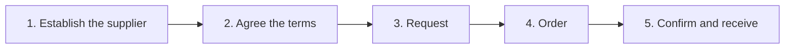

# Sourcing & Procurement

> [!NOTE]
> Part of [Integrated Supply Chain](../overview.md). One of 7 core domains.

Sourcing & Procurement tracks who the business buys from, on what terms, what it has asked for, what it has committed to buy, and what each supplier has promised in return.

## Why it matters

This is the supply-side commercial record of ISC. Maintenance, planning and delivery all resolve their supplier and purchase order references here. The domain keeps standing information apart from individual purchases. Suppliers, their sites and the agreed terms describe who the business can buy from. Requisitions, orders and confirmations describe each purchase, from the first request to the supplier's reply.

## Key concepts

| Concept | What it is |
|---|---|
| Supplier | A vendor the business buys materials or services from. |
| Supplier facility | A physical site of a supplier, such as a plant, warehouse or office. |
| Supplier–material terms | What one supplier charges for one material, with its lead time, order limits and delivery performance. They belong to that pair, not to either side alone. |
| Sourcing record | The approved terms for buying one material from one supplier for one site: price, order quantities, tolerances and validity dates. |
| Framework contract | A long-term agreement with a pre-negotiated price, quantity or value, under which many purchase orders can be raised. |
| Purchase requisition | An internal request to buy a material, made before a purchase order exists. |
| Purchase order | The formal commitment to a supplier, with a header and one or more lines. |
| Order confirmation | The supplier's reply to an order line, stating the quantity and dates it commits to. A line can have several. |
| Incoterms | Standard trade terms, such as EXW, FOB or DAP, that say where risk and cost pass from supplier to buyer. |
| Delivery tolerance | How far a delivery may go over or under the ordered quantity and still be accepted. |
| OTIF | On time, in full. The delivery performance score held for a supplier and material. |

## From supplier to receipt

**Set up (once per supplier)**

1. **Establish the supplier.** A vendor is recorded with its sites and the materials it supplies.
2. **Agree the terms.** Long-term agreements are captured as contracts, and approved supplier, material and site terms as sourcing records. A sourcing record can point at the contract that governs it.

**For each purchase**

3. **Request.** A need to buy is raised as a purchase requisition, either by hand, by planning, or from a maintenance work order. It states the material, quantity, destination and need-by date.
4. **Order.** The requisition becomes a purchase order. Each line points back to the requisition, the supplier, the sourcing record and the contract.
5. **Confirm and receive.** The supplier confirms each line, and a line can receive a sequence of confirmations. Planned inbound deliveries are created in [Shipment & Delivery](./shipment-and-delivery.md). Receipt and invoicing progress is tracked on the order line.

## How it connects

- **[Material Management](./material-management.md)**: supplier terms apply to one specific material, and received goods go into stock.
- **[Shipment & Delivery](./shipment-and-delivery.md)**: inbound deliveries are planned against order lines and supplier confirmations.
- **Asset Maintenance**: a work order can raise a requisition for the parts it needs.
- **[Organizational Foundation](./organizational-foundation.md)**: purchasing organizations and supplier site locations sit in its hierarchies.

## Questions it helps answer

**Who, and on what terms?**
- Who can we buy this material from, and at what price and lead time?
- Which contract governs this purchase?

**What have we asked for and committed to?**
- What requisitions are open, and where did each come from?
- What have we ordered, and how much has been received or invoiced?

**What has the supplier promised?**
- What has the supplier confirmed, and how does it differ from what we requested?
- How reliably does this supplier deliver this material?

## An example

Planning raises a requisition for 1,000 units needed by 15 August. It becomes a purchase order line under an existing framework contract. The supplier confirms in two steps:

| Confirmation | Quantity | Date |
|---|---|---|
| 1 | 800 | 18 August |
| 2 | 200 | 25 August |

Compared with the request, 800 units arrive three days late and the last 200 ten days late. The gap shows on the order line, and it counts toward this supplier's on-time, in-full score for the material.

## Things to know

- **Terms belong to the pair.** Price, lead time and delivery performance are held for one supplier and one material, not for the supplier in general.
- **A line can have several confirmations.** The supplier's promise can change over time, and each reply is kept.
- **A requisition comes before an order.** The two are separate records, so you can see what was requested and what was actually ordered.
- **Contracts set the framework, not each order.** One contract can sit behind many orders.

**Next:** [Planning & Forecasting](./planning-and-forecasting.md)