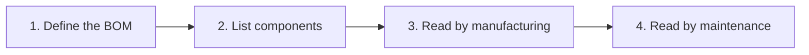

# Technical Structure

> [!NOTE]
> Part of [Integrated Supply Chain](../overview.md). One of 7 core domains.

Technical Structure holds the bills of materials that define what a product, piece of equipment, or functional location is built from — the structure, not the stock.

## Why it matters

Manufacturing and maintenance both need to know what something is made of before they can plan or repair it. Technical Structure is where that one structure lives, so a production schedule and a maintenance work order read the same component list instead of each team keeping its own.

## Key concepts

| Concept | What it is |
|---|---|
| Bill of materials (BOM) | A header record for a parent — a product, a piece of equipment, or a functional location — and the list of components it's built from. |
| BOM category | What kind of parent the BOM is for: a material (a product design), equipment, or a functional location. |
| BOM item | One component line: which material, how many of it per unit of the parent, and whether it's a stock item, a non-stock item, or just a text instruction. |
| Alternative BOM | A different, separately valid parts list for the same parent — for example a substitute recipe. |
| Spare part flag | Marks a component as one maintenance can order as a spare, on top of its role in the original assembly. |
| Validity dates | The window during which a BOM, or one of its items, is the active structure. |

## From design to the shop floor or work order

1. **Define the BOM.** A header is created for a product (a material BOM), a piece of equipment, or a functional location, with a status, a usage (production or plant maintenance), and a validity window.
2. **List components.** Each component is a line on the BOM: the material, the quantity needed per unit of the parent, its unit of measure, and whether it's a stock item, a non-stock item, or a text instruction.
3. **Read by manufacturing.** A product's BOM is what its recipe is built from — Manufacturing reads it to know what one production run consumes.
4. **Read by maintenance.** An equipment or functional-location BOM is what a work order reads to know which spare parts a repair needs, and where they're normally stored.

## How it connects

- **[Material Management](./material-management.md)**: every BOM component is a direct relation to a `MaterialMaster` record — the same material record every other domain uses.
- **Manufacturing**: a product definition points back to the material BOM that defines what it's made of.
- **Asset Maintenance**: an equipment or functional-location BOM points at the asset it belongs to, and its components can be flagged as spare parts a work order might need.

## Questions it helps answer

**What does this build from?**
- What components make up this product, piece of equipment, or functional location?
- How much of each component does one unit need?

**Is there another way to build it?**
- Is there an alternative BOM for this parent, and is it currently valid?

**What's a spare, and where does it live?**
- Which components on this equipment's BOM are flagged as spare parts?
- Where is a component normally stored?

## An example

A compressor's equipment BOM lists 12 components. One of them, a seal kit, is flagged as a spare part and stored in a specific bin. When a work order is raised against the compressor, it reads this same BOM to show which seal kit to use — not a separate maintenance parts list.

## Things to know

- **One structure, two readers.** The same BOM pattern covers both a product's recipe and a piece of equipment's parts list — only the BOM category differs.
- **Components point at Material Management, not a separate parts catalog.** A BOM item's material is the same `MaterialMaster` record procurement and inventory use.
- **A BOM can be superseded, not just edited.** An alternative BOM is a separate, dated record, not an overwrite — the earlier structure is still there if you need to ask what was valid as of a past date.

---

**Next:** [Customer Demand Fulfilment](./customer-demand-fulfilment.md)
