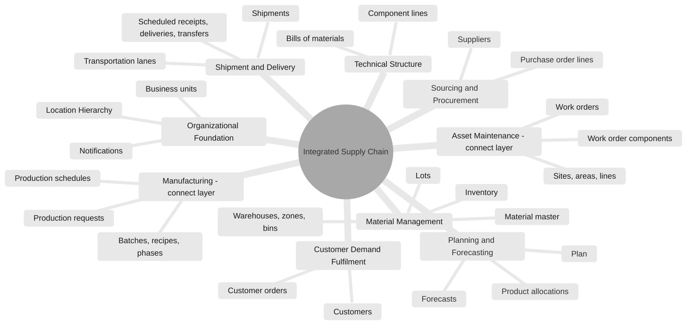

# Integrated Supply Chain: what it is

*ISC shows a manufacturer's whole supply chain as one connected picture, so you can follow a question across departments.*

**Who this is for:** planners, operators, analysts, and executives who want to understand what Integrated Supply Chain (ISC) models and how its parts fit together. No technical background needed — this page doesn't cover installation, configuration, or how the data is built. If you're deploying ISC, start at [implementation](../isc-deployment/1-overview-and-prerequisites.md) instead.

---

## What a supply chain is

A manufacturer's supply chain comes down to four activities: plan what's needed, make it, move it, and maintain the equipment that makes it. You can think of the domains in four stages, roughly as follows:

| Stage | Domains |
|---|---|
| Plan | Planning & Forecasting, Customer Demand Fulfilment |
| Make | Manufacturing, Material Management, Technical Structure |
| Move | Shipment & Delivery, Sourcing & Procurement |
| Maintain | Asset Maintenance |

One domain, Organizational Foundation, underlies all four — it holds the business units and locations that every other domain is organized by, plus the notification inbox that tracks events across all of them. Technical Structure also serves Maintain, not just Make — the same bill-of-materials structure a production schedule reads is what a maintenance work order reads for spare parts.

---

## The problem it solves

Most supply-chain questions cross more than one system. Ask "if this supplier fails, which shipments and customer orders are affected?" and the honest answer usually means pulling data out of several separate tools — an ordering system, a shipment tracker, a spreadsheet — and matching it all by hand. That match has to be redone every time someone asks, and it's only as fresh as whoever last pulled the data.

ISC keeps the connections between things — a reservation, a delivery, a shipment's link to an order — stored as part of the data itself, not something rebuilt each time. The same supplier-failure question becomes a matter of following existing connections instead of starting a fresh investigation.

---

## The nine domains: 7 core, 2 connect layers

*7 of these are core domains, delivered end-to-end by ISC and covered by a dedicated page below. The other 2 — Asset Maintenance and Manufacturing, marked "connect layer" — aren't; they're where the core model connects to a customer's own existing maintenance and manufacturing systems (see [What's fixed vs. what's customer-specific](#whats-fixed-vs-whats-customer-specific)).*

| Domain | What it covers | Learn more |
|---|---|---|
| Organizational Foundation | Business units, locations, notifications | [Page](./domains/organizational-foundation.md) |
| Material Management | Materials, lots, inventory, warehouses | [Page](./domains/material-management.md) |
| Technical Structure | Bills of materials, component lines | [Page](./domains/technical-structure.md) |
| Asset Maintenance | Sites, work orders | — |
| Customer Demand Fulfilment | Customers, customer orders | [Page](./domains/customer-demand-fulfilment.md) |
| Manufacturing | Production schedules, batches, recipes | — |
| Shipment & Delivery | Transportation lanes, shipments, deliveries | [Page](./domains/shipment-and-delivery.md) |
| Sourcing & Procurement | Suppliers, purchase orders | [Page](./domains/sourcing-and-procurement.md) |
| Planning & Forecasting | Forecasts, allocations | [Page](./domains/planning-and-forecasting.md) |

Maintenance and manufacturing look different at every company, so ISC adapts to each customer's own systems there.

### Asset Maintenance

Represents the physical operating structure — sites, areas, and production lines — and the maintenance work orders raised against it, so upkeep is tracked against the same locations used everywhere else in the graph. Each work order lists the components it consumes and distinguishes the plant where it was planned from the plant where it was executed, which matters once maintenance work crosses site boundaries.

### Manufacturing

Turns demand into workable production plans — production requests and schedules, broken into the batches, recipes, and phases that make them up. A schedule connects to the equipment and personnel assigned to it, any notifications raised against it, and the customer orders it's pegged to fulfill, so its full operating context can be read straight from the graph instead of assembled from separate systems.

---

## What's fixed vs. what's customer-specific

The core model — the supply-chain schema itself, and the agent that reads it — is the same across every deployment and is never modified or forked per customer. Maintenance and manufacturing are "connect layers": the wiring between that fixed core and whatever CMMS or ISA-95/ISA-88 systems a specific customer already runs, and that wiring is where customer-specific integration is added instead. This is a structural property of the offering, independent of how any one deployment is configured.

---

## How it connects

Connections between things, such as a material reserved for an order, a shipment carrying a material, or a supplier agreeing to a price, carry their own details: how much, who's involved, and from when to when. Nothing has to be pieced together from separate systems.

Because these connections carry their own dates, you can ask what was true as of a specific day, not just what's true right now. A reservation that expired last month won't show up as active just because no one removed it.

For example, the same lot of stock can be reserved by maintenance, committed to a customer order, and reserved for a production run all at the same time — as three separate reservations, each with its own quantity and dates. Nothing forces a single owner onto the stock; the records show exactly who holds what, and for how long.

---

## Asking questions

Because ISC keeps supply-chain data connected rather than scattered, you can ask questions in plain English and get an answer that spans more than one department. Ask through the Integrated Supply Chain assistant in Atlas, Cognite Data Fusion's chat. A few examples:

- "Which customer orders are affected if this supplier is delayed?"
- "What's reserved against this material right now, and for what?"
- "Which open notifications affect this production schedule?"

---

## Terms you'll see

- **Lot** — a specific quantity of a material produced or received together, tracked separately from other quantities of the same material.
- **Reservation** — stock set aside for a specific order, work order, or production run.
- **Pegging** — linking a schedule or allocation to the customer order it's meant to fulfill, or a purchase order line to the delivery it covers.
- **Transportation lane** — a route a shipment travels between two locations.
- **Purchase order** — an order placed with a supplier for materials.
- **Work order** — a maintenance job raised against equipment or a site.
- **Bill of materials** — the list of components that make up a product.
- **Batch** — one production run of a recipe, tracked as its own record.
- **Recipe** — the set of steps and materials used to produce a batch.
- **Notification** — an operational event, such as a delay or quality issue, tracked until resolved.
- **Forecast** — an expectation of future customer demand.
- **Allocation** — production or inventory reserved against a forecast, before it becomes a firm order.
- **Hierarchy** — a tree structure, such as business units or locations, used to scope a question.

---

## What's next

- Read a domain page above for the business detail behind any of the 7 core domains. Asset Maintenance and Manufacturing are covered inline above instead, since they're connect layers rather than dedicated pages.
